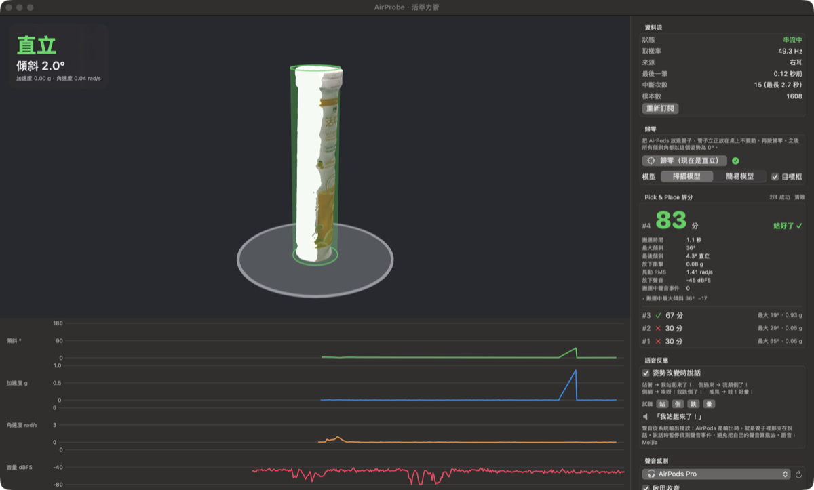

<h1 align="center">AirProbe</h1>

<p align="center">
  Use one AirPod as a live motion + sound sensor <b>inside an object</b> for robot experiments.<br>
  把單支 AirPods 塞進物體裡，當成即時的六軸＋聲音感測器，拿來評估機器人 pick & place 做得好不好。
</p>

<p align="center">
  <a href="https://github.com/dAAAb/AirProbe/releases/latest"></a>
  
  <a href="LICENSE"></a>
</p>

<p align="center"></p>

**[Download AirProbe](https://github.com/dAAAb/AirProbe/releases/latest)**: a signed and notarized DMG. Open it and drag the app to Applications.

AirProbe is built on [AirPoise](https://github.com/jaskirat1616/AirPoise) by Jaskirat Singh (MIT), a menu-bar
posture app that reads the AirPods' head-tracking sensors. That app is still included here (see below).
AirProbe reuses its motion layer and points it at objects instead of heads. AirProbe additions © 2026 dAAAb, also MIT.

## 它能做什麼

把一支 AirPods 放進罐子或管子裡（示範物件是 14.25 cm × Ø3.3 cm 的發泡錠管），App 會：

- **3D 即時顯示物體姿態**：內附 Object Capture 掃描模型，也可以切換成參數化的簡易模型。
- **判斷狀態**：直立、傾斜、躺平、倒立、移動中、自由落體（掉落）。
- **自動評分 pick & place**：拿起、搬運、放下，靜止 0.6 秒後打分數。評分項目是最後有沒有站好、搬運中最大傾斜、放下衝擊、晃動程度、有沒有掉落。
- **聲音感測**：用 AirPods 或 Mac 的麥克風量音量、偵測碰撞聲，跟 IMU 共用同一個時鐘，並能自動算出兩者的時間差。
- **會說話**：站起來說「我站起來了！」，倒過來說「我顛倒了！」，側躺說「唉呀！我跌倒了！」，搖晃說「哇！好暈！」。可開「放大＋壓縮器」增強音量，平均響度約 +7 dB。
- **錄音**：獨立的 WAV 錄音器，也可以跟 CSV 一起錄。
- **輸出給機器人**：錄成 CSV（原始樣本）、JSONL（每次評分），或用 UDP JSON 即時串流，附 Python 接收範例 `scripts/probe_receiver.py`，可以接進 LeRobot 等流程。

## 快速開始

1. AirPods（Pro / 3 / 4 / 5 / Max）連上 Mac，設為聲音輸出。
2. **關掉「自動耳朵偵測」**（系統設定 → 你的 AirPods），不然耳機離開耳朵就會停止送動作資料。
3. 打開 AirProbe，允許「動作與健身」（要收音的話再允許麥克風）。
4. 一支耳機放進物體（另一支留在充電盒），物體立正放好，按「歸零」。
5. 拿起、搬動、放下，看評分。

實測（AirPods Pro、macOS 27）：動作資料約 50 Hz，一次只會從一支耳機送資料。AirPods 麥克風開啟時藍牙會切到通話模式，輸入變成 24 kHz，動作資料仍持續，但切換時可能中斷幾秒。

詳細說明、演算法與限制見 [docs/AirProbe.md](docs/AirProbe.md)。

## 從原始碼建置

```bash
./scripts/build-probe.sh && open dist/AirProbe.app   # development build
swift test --package-path .                          # unit tests
python3 scripts/probe_receiver.py                    # receive the UDP stream
# signed + notarized DMG (needs your own Developer ID and a notarytool profile)
SIGN_IDENTITY="Developer ID Application: …" NOTARY_PROFILE=… ./scripts/release-probe.sh
```

| Path | What |
|---|---|
| `Sources/AirPoiseCore/Probe.swift` | Object-IMU analyzer: tilt from gravity, state, trial scoring (unit-tested) |
| `Sources/AirProbe/` | AirProbe app: 3D scene, audio sensor, voice, recorder, UDP/CSV |
| `Resources/Probe/huocuili.usdz` | Object Capture scan of the demo tube |
| `docs/AirProbe.md` | Details and limits |

---

# AirPoise (upstream app, still included)

The original menu-bar app is unchanged. Build it with `./scripts/build-app.sh`. Its documentation follows.

AirPoise reads the motion sensors already inside AirPods (the same ones Spatial Audio uses). It does two jobs:

1. **Posture** — reminds you when your chin drifts forward or your head tilts.
2. **Head shortcuts** — nod, shake, glance, or tilt to play/pause, switch desktops, run a Mac shortcut, open a link, and more.

No camera. No account. No internet. It lives in the menu bar, not the Dock.

This is the **Mac app**. It is not the sitting cushion sold at airpoise.com.

---

## Quick start

1. Install from the [DMG](https://github.com/jaskirat1616/AirPoise/releases/latest) (or build from source below).
2. Put on **AirPods Pro / 3 / 4 / Max** or **Beats Fit Pro**, and set them as the Mac’s sound output.
3. Allow **Motion & Fitness** when asked.
4. Sit the way you want to sit, look at the screen, and **Calibrate upright**.
5. Click the menu-bar icon for the live readout. Right-click for Pause / Calibrate / **Settings** / Quit.

If macOS blocks the app: right-click AirPoise → **Open**.

---

## How to control it (shortcuts and more)

Everything is in **Settings** (right-click the menu-bar icon → Settings).

### Actions — pick what each head move does

Open **Settings → Actions**. Tap a gesture, then choose what it should do.

| You can bind a gesture to… | Examples |
|---|---|
| Keyboard shortcut | Record ⌘⇥, media keys, anything you type |
| Apple Shortcuts app | Run a Shortcut by name |
| Open a link or an app | URL, or pick an `.app` |
| Media / volume / brightness | Play-pause, next, mute, brighter |
| Mac system stuff | Mission Control, Spaces, screenshot, lock, Spotlight, sleep |
| Notification, speak, or paste text | A ping, a spoken line, clipboard paste |
| Shell or AppleScript | Only if you write that command yourself |
| Nothing | Leave it unassigned |

**Out of the box**

| Head move | What it does |
|---|---|
| Double nod | Play / Pause |
| Look left / look right | Switch Space (desktop) |
| Hold left tilt | Mission Control |
| Double shake | A small ping notification |
| Everything else | Off until you assign it |

Turn a gesture off by setting its action to **Do nothing**, or disable **Head-gesture shortcuts** under **Settings → Gestures**.

Custom keyboard shortcuts need **Accessibility** (Settings → General → Grant). Play/pause and volume usually do not.

### Gestures — how sensitive the moves feel

**Settings → Gestures**

- Master on/off for all head shortcuts
- **Sensitivity** — easier or harder to trigger
- **Cooldown** — wait between triggers so you don’t double-fire
- **Hold duration** — how long to hold a tilt
- A list of all 16 moves with a short how-to for each: nod, double nod, shake, look left/right/up/down, tilt, hold-tilt, lean, roll

A shortcut fires when you move and **come back**. Sitting still in a slouch is not a nod.

### Posture — how strict the coach is

**Settings → Posture**

- Turn the coach on or off
- How many degrees of forward lean count as good vs “nudge me”
- How long you must stay there before a reminder
- Overlay card, notification, sound, or spoken cue
- Ignore you while walking

Calibrate again any time from the menu bar if your chair or desk changes.

### General

Launch at login, menu-bar style, Motion & Accessibility status, and invert an axis if a direction feels backwards on your buds.

---

## What you need

- **macOS 14 Sonoma** or later
- AirPods with **head tracking**: Pro, 3, 4, Max, or Beats Fit Pro, worn and selected as Mac audio output
- Original AirPods / AirPods 2 will not work (no motion sensor). The menu bar will say “No head-tracking buds”

---

## Honest limits

- It sees **head pose**, not your whole spine. A level head on a rounded back still reads “good”.
- About 25 samples a second. Fine for sitting and discrete gestures, not a VR headset.
- Intel Macs on Sonoma may run. Apple Silicon is what we test.

---

## Privacy

Nothing is uploaded. No analytics. Settings stay in `~/Library/Application Support/AirPoise/`. See [SECURITY.md](SECURITY.md).

---

## Download

**[AirPoise-1.0.0.dmg](https://github.com/jaskirat1616/AirPoise/releases/latest)** — drag onto Applications.

## Build from source

Always run the **`.app`**, not the raw `swift build` binary. macOS needs `NSMotionUsageDescription` in the app bundle.

```bash
./scripts/build-app.sh
open dist/AirPoise.app
```

```bash
./scripts/make-dmg.sh          # disk image
swift test --package-path .    # tests
```

---

## How the sensors work (for developers)

Apple already fuses the AirPods accelerometer + gyro for Spatial Audio. AirPoise does not invent a second compass. It reads `CMDeviceMotion` (~25 Hz).

Headphone frame: **x = right ear, y = nose, z = crown**. Relative pose is `ref⁻¹ · q`. Gyro: turn = ωz, nod = ωx, ear tilt = ωy. Invert any axis in Settings → General if firmware feels backwards.

| Field | Used for |
|---|---|
| `attitude` | Gestures (yaw / pitch / roll vs calibrate) |
| `gravity` | Posture (chin-forward and side tilt). Survives taking the buds out |
| `rotationRate` | Flick energy, hold-still, walk rejection |
| `userAcceleration` | Ignore tracking while you walk |
| `sensorLocation` | Which bud is the motion source |

Smoothing is a 1€ filter. A watchdog re-subscribes after idle/wake. Ear detection connect/disconnects as you put buds in or take them out.

| Path | What |
|---|---|
| `Sources/AirPoiseCore` | Math, pose, gestures, posture, settings. No AppKit |
| `Sources/AirPoise` | Menu bar, first-launch window, overlays, Settings |
| `Tests/AirPoiseTests` | Unit tests |
| `scripts/build-app.sh` | Build the `.app` |

## Uninstall

Quit AirPoise, delete the app, and optionally:

```bash
rm -rf ~/Library/Application\ Support/AirPoise
```

Turn off Login Items if you enabled launch-at-login.

## License

[MIT](LICENSE) © 2026 Jaskirat Singh

Onboarding fonts: [Bangers](https://github.com/googlefonts/bangers) and [Archivo Black](https://github.com/Omnibus-Type/ArchivoBlack) (SIL OFL), in `Resources/Fonts/`.
